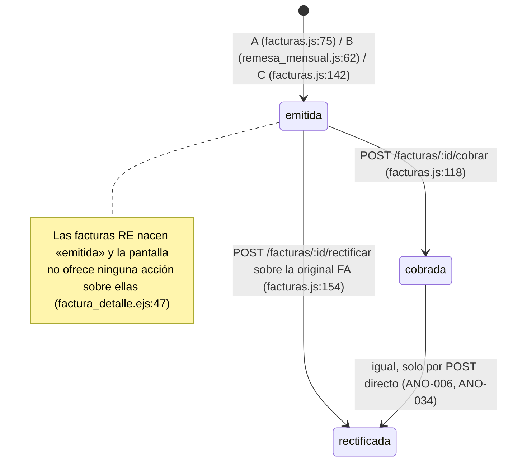

# Ciclo de vida de una factura — GesFact 2.4

| Campo | Valor |
|---|---|
| Fecha de elaboración | 13/11/2026 |
| Versión del código analizada | commit `76ae089` (rama `master`); el código fuente no ha cambiado desde `1f35d01`, la versión del [mapa del sistema](mapa-sistema.md) (`git diff --stat 1f35d01 HEAD` sin cambios fuera de `specs/` y `CLAUDE.md`) |
| Fuentes | Lectura completa de `routes/facturas.js`, `scripts/remesa_mensual.js`, `services/calculo.js`, `lib/numeracion.js`, `lib/util.js`, `db.js`, `routes/contratos.js`, `services/email.js` y las vistas implicadas; cálculo en memoria con `services/calculo.js` y `lib/util.js` (apéndice A) |
| Datos reales consultados | **Ninguno.** No existe `datos/gesfact.db` en la copia de trabajo y no se ha abierto ninguna base de datos. Tampoco se ha ejecutado el servidor ni la remesa: no hay `node_modules` y no se ha lanzado `npm install` para no arriesgar cambios en `package-lock.json` (Principio IV) |

**Convenciones.** Igual que en el [mapa del sistema](mapa-sistema.md): cada paso lleva su evidencia
`fichero:líneas`; lo que no tiene evidencia se marca **SUPOSICIÓN** y remite a una pregunta del apartado 9.
Los hallazgos usan identificadores `ANO-NNN` **provisionales**: del ANO-001 al ANO-031 están en el apartado
6 del mapa; los nuevos de este documento empiezan en ANO-032 (apartado 8). No se corrige nada.

---

## 1. Resumen

**Hay exactamente tres caminos que crean facturas**, y se ha comprobado que no hay más. Al buscar
`INSERT INTO facturas` en todos los ficheros versionados (13/11/2026) aparecen solo estos cuatro sitios:

| Camino | Disparador | Serie | Código |
|---|---|---|---|
| **A. Alta manual** | Oficina, pantalla «Nueva factura» (`POST /facturas/nueva`) | `FA` | `routes/facturas.js:42-102` |
| **B. Remesa mensual de contratos** | Línea de comandos: `node scripts/remesa_mensual.js AAAA-MM` | `FA` | `scripts/remesa_mensual.js:23-78` |
| **C. Rectificación (abono total)** | Oficina, botón «Rectificar» del detalle (`POST /facturas/:id/rectificar`) | `RE` | `routes/facturas.js:129-164` |
| *(no es un camino)* Datos semilla | Solo si la tabla `clientes` está vacía | `FA`/`RE` | `db.js:83-87,122-179` |

Sobre la semilla: se carga una sola vez, en una BD vacía (`db.js:85-86`), con importes escritos a mano y
sin pasar por el cálculo (ANO-013). No forma parte del ciclo de vida, aunque se dispara también si se
arranca el programa desde otra carpeta (ANO-029).

Hay **un solo cambio posterior a la creación: el campo `estado`**, y solo lo modifican dos sentencias en
todo el código: `routes/facturas.js:118` (→ `cobrada`) y `routes/facturas.js:154` (→ `rectificada`). No
hay ningún `DELETE` ni ningún `UPDATE` sobre `lineas`: la búsqueda de `DELETE FROM`, `UPDATE facturas` y
`UPDATE lineas` en los ficheros versionados (13/11/2026) solo encuentra esas dos líneas.

---

## 2. Piezas comunes

Los caminos A y B comparten el cálculo, y los tres comparten la numeración y las tablas. Se describen aquí
una vez y los apartados 3 a 5 remiten a esta sección.

### 2.1 `calculo.calcularFactura(lineas, cliente)` — `services/calculo.js:48-88`

Entrada: `lineas` = `[{descripcion, cantidad, precio, tipoIva}]` sin calcular; `cliente` = cualquier
objeto con `recargo_equivalencia`. Es el único campo que se lee (`services/calculo.js:49`).

| Paso | Qué hace | Evidencia |
|---|---|---|
| 1 | `conRecargo` es verdadero si `cliente.recargo_equivalencia == 1` (comparación no estricta) | `services/calculo.js:49` |
| 2 | **Base bruta**: para cada línea llama a `calcularLinea(cantidad, precio, tipoIva, conRecargo)` y acumula `redondear2(baseBruta + c.base)` | `services/calculo.js:53-58` |
| 3 | `calcularLinea`: `base = redondear2(cantidad × precio)`; `cuotaIva = redondear2(base × tipoIva / 100)`; si hay recargo, `cuotaRecargo = redondear2(base × recargoPara(tipoIva) / 100)`, y si no, 0 | `services/calculo.js:26-34` |
| 4 | `recargoPara`: 21→5,2; 10→1,4; 4→0,5; 18 y 16→4; 8 y 7→1; cualquier otro→0 | `services/calculo.js:12-23` |
| 5 | **Descuento por volumen**: `porcentajeDescuento(baseBruta)` → 5 si es > 5000, 2 si es > 1000 y 0 en otro caso (estrictamente mayor, ANO-023) | `services/calculo.js:39-43,60-61` |
| 6 | **Recálculo con descuento**, línea a línea: `precioConDto = redondear2(precio × (100 − dto) / 100)` y se vuelve a llamar a `calcularLinea` con ese precio. El precio que se devuelve (y se graba) es el que ya lleva el descuento | `services/calculo.js:65-80` |
| 7 | Totales de cabecera acumulados con redondeo en cada suma: `base`, `iva`, `recargo` | `services/calculo.js:81-83` |
| 8 | `total = redondear2(base + iva + recargo)` | `services/calculo.js:86` |
| 9 | Devuelve `{lineas:[{descripcion, cantidad, precio, tipoIva, base, cuotaIva, cuotaRecargo}], base, iva, recargo, total, descuentoPct}` | `services/calculo.js:50,72-80,87` |

Todo redondeo pasa por `util.redondear2(x) = Math.round(x * 100) / 100` (`lib/util.js:5-7`, ANO-025). Si
una cantidad o un precio llegan como `NaN`, el resultado es `NaN` en la línea y en todos los totales
(verificado en memoria; apéndice A, caso 5).

### 2.2 `numeracion.siguienteNumero(serie, cb)` — `lib/numeracion.js:14-42`

| Paso | Qué hace | Evidencia |
|---|---|---|
| 1 | `anyo = new Date().getFullYear()`: el año sale del **reloj del equipo**, no de la fecha de la factura (ANO-002) | `lib/numeracion.js:15` |
| 2 | `SELECT ultimo FROM contadores WHERE serie = ? AND anyo = ?` | `lib/numeracion.js:16` |
| 3 | Si no hay fila (primer número del año): `INSERT INTO contadores (serie, anyo, ultimo) VALUES (?,?,0)` y continúa con `ultimo = 0`. Si dos emisiones simultáneas abren el año, la segunda falla por la clave primaria `(serie, anyo)` y devuelve error (variante de ANO-001) | `lib/numeracion.js:17-23`; `db.js:77-81` |
| 4 | `reservar`: `nuevo = ultimo + 1`; `UPDATE contadores SET ultimo = nuevo`. Se lee y se escribe en dos sentencias sin transacción (ANO-001) | `lib/numeracion.js:30-36` |
| 5 | `formatear`: `SERIE-AAAA-NNNNNN`, con el número relleno con ceros a la izquierda hasta 6 cifras | `lib/numeracion.js:38-42` |

El contador **se incrementa antes** de grabar la factura. Si la grabación posterior falla, el número queda
consumido y hay un hueco en la serie (ANO-003). En la tabla `facturas`, `numero` es `TEXT NOT NULL` y no
tiene restricción de unicidad (`db.js:52`).

### 2.3 Tablas que se escriben

| Tabla | Campos relevantes | Evidencia |
|---|---|---|
| `contadores` | `serie`, `anyo`, `ultimo`; clave primaria `(serie, anyo)` | `db.js:77-81` |
| `facturas` | `numero`, `serie` (por defecto `'FA'`), `cliente_id`, `fecha`, `vencimiento` (puede ser NULL), `base`, `iva`, `recargo`, `total`, `estado` (por defecto `'emitida'`; el comentario lista `emitida / cobrada / rectificada`), `rectifica_a`, `observaciones`. **No hay fecha de cobro ni copia de los datos del cliente** | `db.js:50-63` |
| `lineas` | `factura_id`, `descripcion`, `cantidad`, `precio`, `tipo_iva`, `base`, `cuota_iva`, `cuota_recargo`. **No hay referencia al artículo ni al contrato de origen** | `db.js:65-74` |

El orden de escritura es el mismo en los tres caminos: **`contadores` → `facturas` → `lineas`** (y, en C,
otra vez `facturas`). Cada sentencia va por separado y sin transacción (ANO-004).

---

## 3. Camino A — Alta manual desde la web

### 3.1 Entradas

| Entrada | Origen | Evidencia |
|---|---|---|
| `cliente_id` | Desplegable con los clientes `activo = 1`, ordenados por nombre | `routes/facturas.js:31`; `views/factura_nueva.ejs:6-8` |
| `fecha` | `<input type="date">` opcional; vacío → hoy | `views/factura_nueva.ejs:9`; `routes/facturas.js:44` |
| `desc[]`, `cant[]`, `precio[]`, `iva[]` | 6 filas fijas; `cant` vale 1 por defecto; `iva` es un desplegable con 21, 10 o 4 | `views/factura_nueva.ejs:13-20` |
| Autorrelleno | Al elegir un artículo del `datalist` (artículos `activo = 1`), el navegador copia `precio` y `tipo_iva` del catálogo. Solo viaja el **nombre** del artículo como descripción, no su id | `routes/facturas.js:33`; `views/factura_nueva.ejs:22-24`; `public/js/factura.js:3-15` |
| `obs` | Texto libre opcional | `views/factura_nueva.ejs:25` |

### 3.2 Recorrido paso a paso

Módulos que atraviesa, en este orden: `views/factura_nueva.ejs` → `routes/facturas.js` → `db.js`
(cliente) → `services/calculo.js` → `lib/util.js` (vencimiento) → `lib/numeracion.js` → `db.js`
(cabecera y líneas) → `services/email.js` → redirección a `routes/facturas.js` (detalle).

| # | Qué ocurre | Evidencia |
|---|---|---|
| A1 | `clienteId = parseInt(cliente_id, 10)`; `fecha = req.body.fecha \|\| util.hoy()`. La fecha no se valida | `routes/facturas.js:43-44`; `lib/util.js:10-15` |
| A2 | Lee el cliente con `SELECT * FROM clientes WHERE id = ?`. Si no existe → **400** «Cliente no valido». No comprueba si está activo (ANO-031) | `routes/facturas.js:46-47` |
| A3 | Construye las líneas: normaliza cada campo a array; **descarta en silencio las filas sin descripción**, aunque tengan precio; `cantidad` y `precio` = `parseFloat(texto.replace(',', '.'))`, que **solo cambia la primera coma** (ANO-032); `tipoIva = parseInt(iva, 10)`, sin comprobar que sea un tipo conocido (ANO-040) | `routes/facturas.js:50-63` |
| A4 | Sin líneas → **400** «La factura no tiene lineas» | `routes/facturas.js:64` |
| A5 | **Cálculo**: `calculo.calcularFactura(lineas, cliente)` con la fila completa del cliente (apartado 2.1) | `routes/facturas.js:66` |
| A6 | **Vencimiento**: `dias = cliente.dias_pago \|\| config.VENCIMIENTO_DIAS` (30); `util.sumarDias(fecha, dias)`. Un `dias_pago` de 0 se trata como «sin valor» (ANO-041) | `routes/facturas.js:68-69`; `config.js:40`; `lib/util.js:20-26` |
| A7 | **Número**: `numeracion.siguienteNumero('FA', …)` (apartado 2.2). Si falla → **500** «Error numeracion» | `routes/facturas.js:71-72` |
| A8 | **Cabecera**: `INSERT INTO facturas` con `serie = 'FA'`, `estado = 'emitida'` y los totales de `calc`; `rectifica_a` no se pasa y queda NULL; `observaciones = obs + (descuentoPct > 0 ? ' Descuento volumen N% aplicado' : '')` (ANO-024). Si falla → **500**, con el número ya consumido (ANO-003) | `routes/facturas.js:74-78` |
| A9 | **Líneas**: un `INSERT INTO lineas` por cada `calc.lineas`, lanzados a la vez dentro de un `forEach`, con el precio ya descontado. Al terminar la última, si alguna falló → **500**, pero la cabecera y las líneas que sí se grabaron se quedan (ANO-004) | `routes/facturas.js:83-92` |
| A10 | `email.enviarFactura({numero}, cliente, cb)`: no envía nada; escribe en consola «envio desactivado… pendiente de enviar a mano» y llama a `cb(null)` | `routes/facturas.js:93`; `services/email.js:11-29` |
| A11 | Redirige a `/facturas/<id>` (detalle imprimible) | `routes/facturas.js:94` |

### 3.3 Resultado

- **Tablas, en este orden**: `contadores` (UPDATE, o INSERT y UPDATE el primer número del año) →
  `facturas` (1 fila) → `lineas` (N filas).
- **Estado inicial**: `emitida` (`routes/facturas.js:75`).
- **Ejemplo** (verificado en memoria, apéndice A, caso 6): cliente 2, Ferretería El Tornillo, con recargo
  de equivalencia (`db.js:97`); 4 × 18,50 € al 21 % → base 74,00 €, IVA 15,54 €, recargo 3,85 €, total
  93,39 €.

---

## 4. Camino B — Remesa mensual de contratos

### 4.1 Entradas

| Entrada | Origen | Evidencia |
|---|---|---|
| `AAAA-MM` | Argumento de la línea de comandos, validado con `/^\d{4}-\d{2}$/`; si falta o no es válido, muestra el uso y sale con código 1. No comprueba que el mes esté entre 01 y 12 | `scripts/remesa_mensual.js:14-18` |
| Contratos | Tabla `contratos` (`cuota`, `tipo_iva`, `concepto`, `fecha_alta`, `fecha_baja`) unida con `clientes` (`nombre`, `recargo_equivalencia`, `dias_pago`) | `scripts/remesa_mensual.js:26-28`; `db.js:41-48` |
| Momento del lanzamiento | Según los comentarios del código, el día 1, desde el ordenador de Marga. Es un comentario, no un testimonio confirmado (pregunta P-06 del mapa) | `scripts/remesa_mensual.js:5-7`; `views/index.ejs:9-10` |

### 4.2 Recorrido paso a paso

Módulos que atraviesa: `scripts/remesa_mensual.js` → `lib/util.js` (días del mes) → `db.js`
(`inicializar` y consulta) → [por cada contrato] `lib/util.js` (redondeo) → `services/calculo.js` →
`lib/numeracion.js` → `lib/util.js` (vencimiento) → `db.js` (cabecera y línea). No pasa por
`routes/` ni por `services/email.js`.

| # | Qué ocurre | Evidencia |
|---|---|---|
| B1 | `primerDia = AAAA-MM-01`; `ultimoDia = AAAA-MM-<util.diasDelMes>` (días reales del mes) | `scripts/remesa_mensual.js:20-21`; `lib/util.js:36-39` |
| B2 | `db.inicializar`: crea el esquema si falta y, **si la BD está vacía, carga la semilla** (ANO-029) | `scripts/remesa_mensual.js:23-24`; `db.js:17-89` |
| B3 | Selecciona los contratos con `fecha_alta <= ultimoDia AND (fecha_baja IS NULL OR fecha_baja >= primerDia)`. **No filtra** clientes inactivos (ANO-011), **no tiene `ORDER BY`** (ANO-037) y **no comprueba** si el mes ya se facturó (ANO-009). Si no hay ninguno, muestra un aviso y sale con código 0 | `scripts/remesa_mensual.js:26-31` |
| B4 | Procesa los contratos **de uno en uno**: el siguiente empieza cuando se ha grabado la línea del anterior | `scripts/remesa_mensual.js:33-41,72` |
| B5 | **Prorrateo propio (días reales)**: `desde = max(fecha_alta, primerDia)`; `hasta = min(fecha_baja, ultimoDia)`; `diasServicio = díaHasta − díaDesde + 1`; `importe = redondear2(cuota / diasMes × diasServicio)`. **No usa `calculo.calcularProrrateo`** (ANO-007) ni limita el resultado a 0 o más (ANO-042) | `scripts/remesa_mensual.js:45-51` |
| B6 | **Descripción**: `concepto + ' (N dias)'` si `diasServicio < diasMes`; si no, `concepto + ' (<mes> <año>)'` (por ejemplo, «(junio 2026)») | `scripts/remesa_mensual.js:53,80-84` |
| B7 | **Una sola línea**: `{cantidad: 1, precio: importe, tipoIva: co.tipo_iva}` | `scripts/remesa_mensual.js:54` |
| B8 | **Cálculo**: `calculo.calcularFactura(lineas, {recargo_equivalencia})` (apartado 2.1). Se aplica el descuento por volumen si la cuota del mes pasa de 1.000 € (ANO-035) | `scripts/remesa_mensual.js:55` |
| B9 | **Número**: `numeracion.siguienteNumero('FA', …)`. Si falla, sale con código 1 | `scripts/remesa_mensual.js:57-58` |
| B10 | **Fecha** = `ultimoDia` del mes facturado; **vencimiento** = `util.sumarDias(fecha, co.dias_pago \|\| 30)`, con el 30 escrito en el código (ANO-012, ANO-041) | `scripts/remesa_mensual.js:59-60` |
| B11 | **Cabecera**: `INSERT INTO facturas` con `serie = 'FA'`, `estado = 'emitida'` y `observaciones = 'Remesa <mes> <año>'`, sin mención al descuento (ANO-036). Si falla, sale con código 1 (ANO-010) | `scripts/remesa_mensual.js:61-64` |
| B12 | **Línea**: `INSERT INTO lineas` con `calc.lineas[0]`. Si falla, sale con código 1 y la cabecera queda sin línea (ANO-004, ANO-010) | `scripts/remesa_mensual.js:66-70` |
| B13 | Escribe en consola `número  cliente  total eur` y pasa al siguiente contrato | `scripts/remesa_mensual.js:71-72` |
| B14 | Al terminar: «Remesa AAAA-MM terminada: N facturas.» y sale con código 0 | `scripts/remesa_mensual.js:37-39` |

### 4.3 Resultado

- **Tablas, por cada contrato**: `contadores` → `facturas` (1 fila) → `lineas` (1 fila). Los contratos van
  uno detrás de otro.
- **Estado inicial**: `emitida` (`scripts/remesa_mensual.js:62`).
- **Ejemplo** (verificado en memoria, apéndice A, caso 1): contrato 4, Bar Nuevo Siglo, cuota de 90 € y alta
  el 15/02/2026 (`db.js:101,119`), remesa `2026-02` → 14 días de 28 → línea «Alquiler máquina de café
  Futurmat F3 (14 dias)» por 45,00 €; IVA 9,45 €; total 54,45 €; fecha 2026-02-28; vencimiento 2026-03-30.
  Con `calcularProrrateo` el importe sería 42,00 € (ANO-007).

---

## 5. Camino C — Rectificación de una factura existente

### 5.1 Entradas

| Entrada | Origen | Evidencia |
|---|---|---|
| `:id` | La factura que se va a rectificar (en la URL) | `routes/facturas.js:129` |
| `motivo` | Texto libre opcional | `views/factura_detalle.ejs:49-50`; `routes/facturas.js:143` |
| Botón | Solo aparece si `estado === 'emitida'` y `serie === 'FA'`. El servidor no exige que esté `emitida` (ANO-006) | `views/factura_detalle.ejs:47-52` |

### 5.2 Recorrido paso a paso

Módulos que atraviesa: `views/factura_detalle.ejs` → `routes/facturas.js` → `db.js` (original y sus
líneas) → `lib/numeracion.js` → `lib/util.js` (`hoy`) → `db.js` (cabecera RE, líneas RE y estado de la
original). **No pasa por `services/calculo.js`** ni por `services/email.js`.

| # | Qué ocurre | Evidencia |
|---|---|---|
| C1 | Lee la factura original unida con su cliente. Si no existe → **404** | `routes/facturas.js:130-131` |
| C2 | Comprueba el estado y la serie: si ya está `rectificada` → **400**; si es de serie `RE` → **400**. Una factura `cobrada` **sí** se puede rectificar (ANO-006, ANO-034) | `routes/facturas.js:132-133` |
| C3 | Lee sus líneas con `SELECT * FROM lineas WHERE factura_id = ?`, **sin `ORDER BY`** (ANO-037) | `routes/facturas.js:135` |
| C4 | **Número**: `numeracion.siguienteNumero('RE', …)`. Si falla → **500** | `routes/facturas.js:138-139` |
| C5 | **Sin cálculo**: los importes se copian cambiados de signo, a propósito, para que la rectificativa sea «espejo exacto» (comentario atribuido a Puri) | `routes/facturas.js:124-128` |
| C6 | **Cabecera RE**: `INSERT INTO facturas` con `serie = 'RE'`, el mismo `cliente_id`, `fecha = util.hoy()`, `vencimiento = NULL`, `−base`, `−iva`, `−recargo`, `−total`, `estado = 'emitida'`, `rectifica_a` = número de la original y `observaciones = 'Rectifica <número>. ' + motivo` (ANO-038). Si falla → **500**, con el número consumido (ANO-003) | `routes/facturas.js:141-145` |
| C7 | **Líneas RE**: una por cada línea original: `'Rectificación: ' + descripción`, `−cantidad`, **el mismo precio con su signo**, el mismo `tipo_iva`, `−base`, `−cuota_iva` y `−cuota_recargo`. **Los errores no se comprueban**: la función de retorno no recibe el error (ANO-005) | `routes/facturas.js:147-152` |
| C8 | Cuando terminan todas las líneas: `UPDATE facturas SET estado = 'rectificada' WHERE id = <original>`, sin condición sobre el estado anterior y sin comprobar errores. Después redirige a la RE. Si la original no tiene líneas, este paso no llega a ejecutarse nunca (ANO-005) | `routes/facturas.js:153-156` |

### 5.3 Resultado

- **Tablas, en este orden**: `contadores` (serie RE) → `facturas` (fila RE) → `lineas` (N filas) →
  `facturas` (UPDATE del estado de la original).
- **Estado inicial de la RE**: `emitida` (`routes/facturas.js:142`). **Estado de la original**: `rectificada`.
- **Corrección completa**: el sistema solo genera el abono. La factura correcta se emite después **a mano
  por el camino A** (`lib/numeracion.js:5-6`). La semilla tiene un caso así: FA-2026-000106 → RE-2026-000001
  → FA-2026-000107 «Sustituye a FA-2026-000106» (`db.js:156-166`). Entre la RE y la nueva factura no queda
  ningún vínculo en la BD, salvo el texto de observaciones que escriba la oficina.
- **Ejemplo** (por lectura del código): rectificar FA-2026-000107 (`db.js:164-166`) daría
  `RE-<año>-<n>` con −101,61 / −20,62 / 0 / −122,23 y dos líneas: «Rectificación: Alquiler máquina de café
  Futurmat F3 (abril)», −1 × 90,00 → −90,00 / −18,90; y «Rectificación: Café en grano natural 1kg»,
  −0,97 × 11,95 → −11,61 / −1,16. Los importes no cuadran entre sí porque la cabecera de origen tampoco
  cuadra (ANO-013).

---

## 6. Después de la creación: estados y quién los cambia

### 6.1 Estados posibles

| Estado | Quién lo pone | Desde qué estado | Condiciones | Evidencia |
|---|---|---|---|---|
| `emitida` | Los caminos A, B y C al crear la factura; también es el valor por defecto de la columna | — | — | `routes/facturas.js:75,142`; `scripts/remesa_mensual.js:62`; `db.js:61` |
| `cobrada` | Cualquier usuario de la web (no hay autenticación, ANO-017) con «Marcar cobrada» → `POST /facturas/:id/cobrar` | Solo `emitida` (`WHERE … AND estado = 'emitida'`) | Si la factura no está `emitida` o no existe, no hace nada y no avisa. **No comprueba la serie**: una RE se puede marcar `cobrada` con un POST directo (ANO-033). No guarda la fecha de cobro | `routes/facturas.js:117-122`; `views/factura_detalle.ejs:47-48`; `db.js:50-63` |
| `rectificada` | Cualquier usuario de la web, con el camino C, sobre la factura **original** | `emitida` (con el botón) o `cobrada` (solo con un POST directo) | Ser de serie FA y no estar ya `rectificada`. Si estaba `cobrada`, se pierde ese dato (ANO-034) | `routes/facturas.js:132-133,154` |

### 6.2 Lo que no existe

- **No hay transiciones de vuelta** (`cobrada` → `emitida`, «des-rectificar») ni ningún estado más: las
  únicas escrituras de `estado` son `routes/facturas.js:118,154`.
- **No se borra nada ni se modifican importes, líneas, fechas ni números** después de la creación (búsqueda
  del 13/11/2026; apartado 1). Es la política legal que se indica en `lib/numeracion.js:3-6`.
- **Las facturas RE se quedan `emitida` para siempre** en el uso normal: la pantalla no ofrece ninguna
  acción sobre ellas (`views/factura_detalle.ejs:47`). Por eso el panel las cuenta como pendientes de cobro
  (ANO-021).
- **La remesa y los contratos no cambian nunca el estado de una factura**: `scripts/remesa_mensual.js` y
  `routes/contratos.js` no tienen ningún `UPDATE facturas`.
- **Lo que cambia sin tocar la factura**: la vista imprimible y el CSV leen los datos del cliente y de la
  empresa en el momento de la consulta (ANO-019). El informe de IVA suma desde `lineas` y el CSV desde
  `facturas`, de cualquier estado (`routes/informes.js:23-25,36-38`; ANO-014).

---

## 7. Puntos donde dos caminos hacen «lo mismo» con código distinto

| # | Qué se hace | A. Manual | B. Remesa | C. Rectificación | Consecuencia | Anomalía |
|---|---|---|---|---|---|---|
| 1 | **Prorratear una cuota** | No prorratea, pero la pantalla de baja de contrato calcula el importe del último mes con `calculo.calcularProrrateo` (30 días, «a lo comercial», topado entre 0 y 30) y la oficina lo mete a mano por A (`routes/contratos.js:37-40`; `services/calculo.js:95-102`) | Cálculo propio con días reales y sin topes (`scripts/remesa_mensual.js:45-51`) | — | 45,00 € frente a 42,00 € en el mismo caso; posible doble facturación del mes de baja; con baja anterior al alta, la remesa da un importe negativo y la pantalla da 0 | ANO-007, ANO-008, ANO-022, ANO-042 |
| 2 | **Fecha de la factura** | Formulario o `util.hoy()` (`routes/facturas.js:44`) | Último día del mes facturado (`scripts/remesa_mensual.js:59`) | `util.hoy()` (`routes/facturas.js:142`) | En los tres casos, el año del número sale del reloj (`lib/numeracion.js:15`). B es el que más se expone: fecha 31/12 y lanzamiento el 1/1 | ANO-002 |
| 3 | **Vencimiento** | `cliente.dias_pago \|\| config.VENCIMIENTO_DIAS` (`routes/facturas.js:68`) | `co.dias_pago \|\| 30` escrito en el código (`scripts/remesa_mensual.js:60`) | `NULL` (`routes/facturas.js:142`) | Hoy coinciden; dejarían de hacerlo si cambia `config.js`. Ambos ignoran un `dias_pago = 0` | ANO-012, ANO-041 |
| 4 | **Grabar la cabecera** | SQL propio de 11 columnas (`routes/facturas.js:74`) | Copia literal del mismo SQL (`scripts/remesa_mensual.js:61`) | SQL propio de 12 columnas, con `rectifica_a` (`routes/facturas.js:141`) | Tres copias que mantener a la vez | — |
| 5 | **Grabar las líneas** | `INSERT` en un `forEach`, a la vez; comprueba errores al final (`routes/facturas.js:83-92`) | Un único `INSERT`; si falla, sale del proceso (`scripts/remesa_mensual.js:67-70`) | `INSERT` en un `forEach`, a la vez; **ignora los errores** (`routes/facturas.js:148-152`) | El mismo fallo deja un rastro distinto según el camino | ANO-004, ANO-005, ANO-010 |
| 6 | **Calcular importes** | `calcularFactura` (`routes/facturas.js:66`) | `calcularFactura` (`scripts/remesa_mensual.js:55`) | Cambio de signo sin recalcular (`routes/facturas.js:142,150`) | Es intencionado según el comentario (`routes/facturas.js:127-128`); la RE hereda cualquier descuadre de la original | ANO-013 |
| 7 | **Dejar constancia del descuento por volumen** | Añade «Descuento volumen N% aplicado» a las observaciones (`routes/facturas.js:76`) | No lo añade aunque haya descuento (`scripts/remesa_mensual.js:62`) | — | Dos facturas con descuento y distinto rastro | ANO-035, ANO-036 |
| 8 | **Datos del cliente para el cálculo** | La fila completa (`routes/facturas.js:46,66`) | Un objeto con solo `recargo_equivalencia` (`scripts/remesa_mensual.js:55`) | — | **Resultado equivalente**: `calcularFactura` solo lee ese campo (`services/calculo.js:49`) | — |
| 9 | **Filtrar clientes activos** | Solo en la pantalla (`routes/facturas.js:31`); el POST no lo comprueba (`routes/facturas.js:46-47`) | No filtra (`scripts/remesa_mensual.js:26-28`) | No filtra (`routes/facturas.js:130`) | Se puede facturar a clientes dados de baja | ANO-011, ANO-031 |
| 10 | **Aviso de envío por correo** | Llama a `email.enviarFactura`, que solo escribe en el log (`routes/facturas.js:93`) | No lo llama | No lo llama | El log «pendiente de enviar a mano» solo sale para las facturas manuales | — |
| 11 | **Orden de lo que se graba** | Líneas en el orden del formulario. Que los `id` sigan ese orden es una **SUPOSICIÓN**, porque los `INSERT` se lanzan a la vez (`routes/facturas.js:85-86`) | Orden de numeración = orden de la consulta, que no tiene `ORDER BY` (`scripts/remesa_mensual.js:26-28`) | Líneas leídas sin `ORDER BY` (`routes/facturas.js:135`), mientras que el detalle sí ordena por `id` (`routes/facturas.js:109`) | Orden no garantizado por SQL | ANO-037 |
| 12 | **Convertir texto en número** | `parseFloat(texto.replace(',', '.'))` (`routes/facturas.js:59-60`); el alta de contrato hace lo mismo con la cuota (`routes/contratos.js:19`), que luego usa B | Ya recibe números de la BD | Ya recibe números de la BD | «1.234,50» se lee como 1,234 | ANO-032 |

---

## 8. Hallazgos nuevos para el registro de anomalías (propuestos)

Continúan la numeración provisional del mapa del sistema. Ninguno se corrige en esta fase.

| ID | Tipo | Sev. | Descripción | Evidencia | Impacto estimado |
|---|---|---|---|---|---|
| ANO-032 | RIESGO | ALTA | Cantidades y precios (y la cuota de un contrato nuevo) se convierten con `parseFloat(texto.replace(',', '.'))`, que solo cambia la primera coma: «1.234,50» → **1,234**; «1,5» → 1,5. La aplicación muestra los importes con punto de miles (`formatearImporte`), así que copiarlos de la pantalla da un importe erróneo y no hay ningún aviso | `routes/facturas.js:59-60`; `routes/contratos.js:19`; `lib/util.js:51-58`; apéndice A, caso 7 | Factura emitida por un importe mil veces menor; solo se arregla con una rectificativa. Pregunta P-13 |
| ANO-033 | RAREZA | BAJA | `POST /facturas/:id/cobrar` no comprueba la serie ni si la factura existe: una RE puede quedar `cobrada`; si la factura no está `emitida`, la petición no hace nada y no avisa | `routes/facturas.js:117-122`; `views/factura_detalle.ejs:47-48` | Comportamiento que depende de la interfaz |
| ANO-034 | RAREZA | MEDIA | Al rectificar una factura `cobrada` pasa a `rectificada` y se pierde la constancia del cobro (no hay fecha ni marca de cobro aparte) | `routes/facturas.js:132-133,154`; `db.js:50-63` | No se sabe qué abonos hay que devolver al cliente. Pregunta P-16 |
| ANO-035 | RAREZA | ALTA | La remesa aplica el descuento por volumen a las cuotas de más de 1.000 € al mes (cuota de 1.200 € → precio de 1.176 €, total de 1.422,96 €). **SUPOSICIÓN**: no consta si el acuerdo de 2018 («para fidelizar hostelería») incluía las cuotas. En la semilla todas las cuotas son de 145 € o menos | `scripts/remesa_mensual.js:55`; `services/calculo.js:36-43`; `db.js:116-119`; apéndice A, caso 4 | Cuotas facturadas por debajo de lo pactado si existe un contrato así. Pregunta P-14 |
| ANO-036 | RAREZA | BAJA | Solo la factura manual anota «Descuento volumen N% aplicado»; la remesa no | `routes/facturas.js:76`; `scripts/remesa_mensual.js:62` | Facturas con descuento y sin explicación impresa |
| ANO-037 | RAREZA | BAJA | El orden de lo grabado depende de consultas sin `ORDER BY`: los contratos de la remesa (y con ellos el orden de numeración) y las líneas que copia la rectificativa | `scripts/remesa_mensual.js:26-28`; `routes/facturas.js:135` (frente a `:109`) | Numeración o líneas de la RE en un orden imprevisible si SQLite cambia de plan de consulta |
| ANO-038 | RAREZA | BAJA | Sin motivo, las observaciones de la RE terminan en «. » (punto y espacio). El motivo es opcional | `routes/facturas.js:143`; `views/factura_detalle.ejs:50` | Rectificativas sin motivo documentado |
| ANO-039 | RAREZA | MEDIA | Las facturas de remesa de la semilla no tienen la forma que produce el script actual. Tienen varias líneas con artículos (el script graba una sola), observaciones «Remesa enero» sin año (el script pone «Remesa enero 2026») y el sufijo «(enero)» sin año (el script pone «(enero 2026)») | `db.js:126-130,156-158,168-171` frente a `scripts/remesa_mensual.js:53-54,62,80-84` | No sirven como resultado esperado de la remesa; se desconoce cómo se añadieron las líneas de artículos, porque no hay pantalla para editar facturas. Pregunta P-15 |
| ANO-040 | RAREZA | BAJA | El servidor no valida el tipo de IVA de una línea; un tipo no previsto (por ejemplo, 5) se acepta y su recargo de equivalencia es 0 sin avisar | `routes/facturas.js:61`; `services/calculo.js:22` | Solo con un POST que no venga del formulario (`views/factura_nueva.ejs:18`) |
| ANO-041 | RAREZA | BAJA | Un `dias_pago` de 0 (pago al contado) se ignora y se usa 30, porque se aplica `\|\|` | `routes/facturas.js:68`; `scripts/remesa_mensual.js:60`; apéndice A, caso 9 | Vencimiento erróneo para clientes al contado, si los hay |
| ANO-042 | RIESGO | MEDIA | La pantalla de baja no comprueba que la baja sea posterior al alta. Si las dos caen en el mismo mes y la baja es anterior, la remesa calcula días ≤ 0 y emite una factura FA con importe negativo o cero; `calcularProrrateo`, en cambio, la deja en 0 | `routes/contratos.js:31-35`; `scripts/remesa_mensual.js:28,45-51`; `services/calculo.js:100` | Factura FA negativa con número legal consumido |

Precisión sobre **ANO-003** (SUPOSICIÓN del mapa): ya está verificado que `calcularFactura` devuelve `NaN`
en base y total cuando una línea con descripción tiene el precio vacío (apéndice A, caso 5). **Sigue siendo
SUPOSICIÓN** qué hace `sqlite3` al grabar `NaN` en una columna `REAL NOT NULL`: hay que comprobarlo con un
test sobre una copia.

---

## 9. Suposiciones y preguntas abiertas

Continúan la numeración del mapa del sistema (P-01 a P-12).

| ID | Pregunta | Destinatario | Motivo |
|---|---|---|---|
| P-13 | Al teclear cantidades o precios en «Nueva factura», ¿se escribe alguna vez el punto de miles (por ejemplo «1.234,50»)? ¿Se ha visto alguna factura por un importe absurdamente bajo? | Marga | ANO-032 |
| P-14 | ¿El descuento por volumen debe aplicarse también a las cuotas de contrato de la remesa? ¿Hay o ha habido contratos con cuota de más de 1.000 € al mes? | Paco (acordó el descuento según `services/calculo.js:38`) y Marga | ANO-035 |
| P-15 | Las facturas de remesa de enero, abril y mayo de 2026 llevan además café, azúcar o vasos. ¿Cómo se añadieron esas líneas, si la remesa solo graba una y no hay pantalla para editar facturas? | Marga | ANO-039 |
| P-16 | Cuando se rectifica una factura que ya estaba cobrada, ¿cómo se controla la devolución del dinero al cliente? | Marga y Puri (gestoría) | ANO-034 |
| — | Verificar con tests sobre una BD temporal: (1) qué graba `sqlite3` con `NaN` (ANO-003); (2) que una rectificación de una factura sin líneas deja la petición sin respuesta (ANO-005); (3) el orden de los `id` de las líneas de la factura manual (apartado 7, fila 11) | Equipo de documentación (verificación técnica, no es una pregunta al negocio) | Requiere `node_modules`; véase P-11 del mapa |

---

## Apéndice A. Verificación en memoria

**Método**: el 13/11/2026, con Node 26.13.0, se ejecutó un script guardado fuera del repositorio que solo
carga `services/calculo.js` y `lib/util.js` (ninguno de los dos abre la BD). Las fechas dependen de la zona
horaria del equipo (ANO-030).

| Caso | Entrada | Resultado obtenido |
|---|---|---|
| 1 | Remesa `2026-02`, contrato 4: `redondear2(90 / diasDelMes('2026-02-01') × 14)` y después `calcularFactura` al 21 % sin recargo | `diasDelMes` = 28; importe 45; base 45, IVA 9,45, total 54,45, descuento 0 |
| 2 | `calcularProrrateo(90, '2026-02-15', '2026-02-28')` | 42 |
| 3 | Julio de 2026 completo: `diasDelMes('2026-07-01')` y `calcularProrrateo(90, '2026-07-01', '2026-07-31')` | 31; 90 (con 31 días, la remesa también da 90) |
| 4 | `calcularFactura([{cantidad: 1, precio: 1200, tipoIva: 21}], {recargo_equivalencia: 0})` | descuento 2; precio de la línea 1176; base 1176; total 1422,96 |
| 5 | `calcularFactura` con `precio = parseFloat('')` | base `NaN`, total `NaN` |
| 6 | `calcularFactura([{cantidad: 4, precio: 18.5, tipoIva: 21}], {recargo_equivalencia: 1})` | base 74, IVA 15,54, recargo 3,85, total 93,39 |
| 7 | `parseFloat('1.234,50'.replace(',', '.'))`; `parseFloat('1,5'.replace(',', '.'))` | 1.234 (es decir, 1,234); 1.5 |
| 8 | `sumarDias('2026-02-28', 30)`; `sumarDias('2026-02-28', 60)`; `sumarDias('2026-12-31', 30)` | 2026-03-30; 2026-04-29; 2027-01-30 |
| 9 | `0 \|\| 30` (lo que hacen `routes/facturas.js:68` y `scripts/remesa_mensual.js:60` con `dias_pago = 0`) | 30 |
